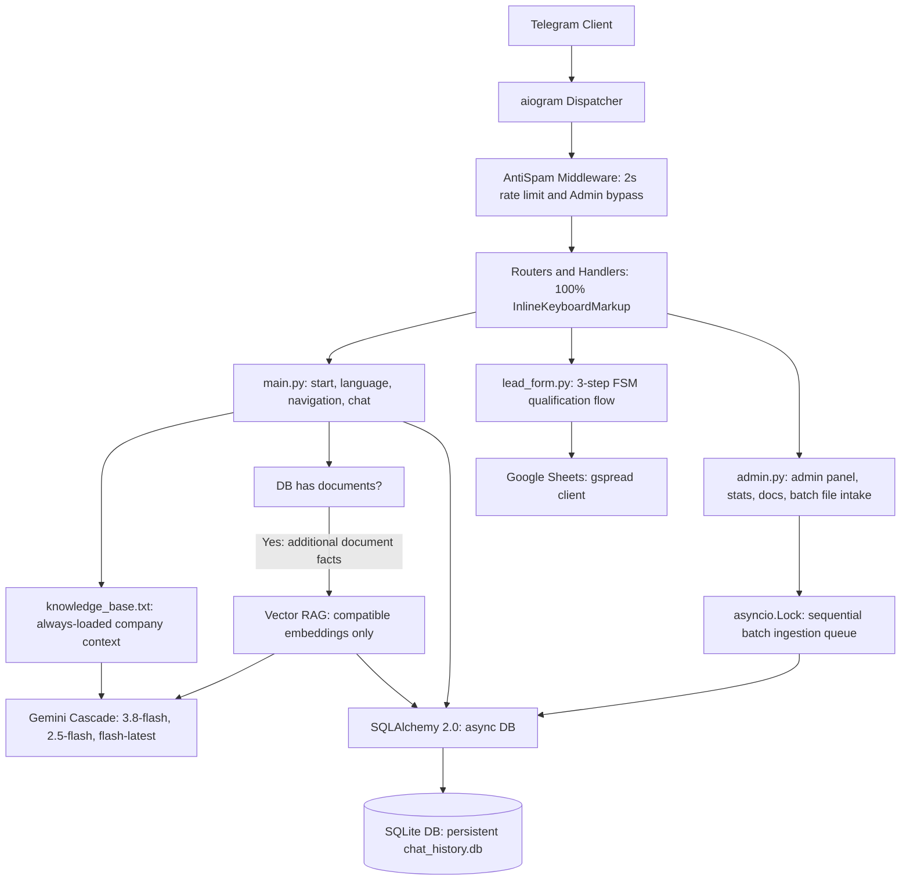

# ai_lead_bot

<div align="center">

[](https://python.org)
[](https://aiogram.dev)
[](https://ai.google.dev)
[](https://github.com/omnilib/aiosqlite)
[](https://pytest.org)
[](https://docker.com)
[](LICENSE)

An asynchronous Telegram bot designed for client consultation, automated lead intake, and document-backed question answering. Built with Python 3.11, aiogram 3.31, Google Gemini Flash, a custom vector RAG pipeline, and SQLite.

[Architecture](#architecture) · [Hybrid Knowledge Base](#hybrid-knowledge-base) · [RAG Engine](#vector-rag-engine) · [Features](#features) · [Quick Start](#quick-start) · [Testing](#testing--verification) · [Docker](#docker-deployment) · [Configuration](#configuration)

</div>

---

## Overview

This project provides an automated sales and support assistant inside Telegram. Unlike simple prompt-wrapper bots, it implements a full Retrieval-Augmented Generation (RAG) system with vectorized document search, table preservation, exact page citations, and fallback cascades across Gemini models.

When a client asks about pricing, services, or technical details, the bot references indexed corporate documents (PDF or DOCX). When a user decides to order a service, an interactive finite state machine (FSM) collects contact details, validates inputs, exports the record to Google Sheets, and alerts the administrator.

---

## Architecture

The bot is designed to be fully non-blocking. Database queries, embeddings, model calls, and external Google Sheets writes run asynchronously or inside dedicated thread pools to keep the event loop responsive.



### Hybrid Knowledge Base

Every consultation includes the company description from `knowledge_base.txt`. Uploaded documents supplement this context instead of disabling it.


#### Company Context and Document Facts
- **Always available:** [`knowledge_base.txt`](knowledge_base.txt) provides general service descriptions and any prices or terms recorded there. Its mtime-based cache reloads changes without restarting the bot.
- **Additional retrieval:** When documents exist, queries are embedded and searched with NumPy cosine similarity. Results use the absolute threshold (`score >= 0.52`) and relative window (`score >= max(0.52, top_score - 0.08)`), with at most four fragments.
- **Fact priority:** Relevant document fragments take precedence over company context for exact prices, tariffs, terms, and regulations. General consultation remains available when no fragments match.
- **Strict sources:** Replies based on documents receive an automatically formatted footer such as `📄 Джерело: price.pdf (стор. 2)`. Internal source identifiers are checked against the retrieved fragments; company-only answers do not cite unused documents.
- **Missing information:** `NO_RAG_ANSWER` is used only when the requested specific facts are absent from both sources.
- **Document removal:** `admin:clear_all_docs` deletes documents and their chunks, invalidates the vector cache, and leaves the company context available.

#### Embedding Compatibility
- `EMBEDDING_MODEL` defaults to `gemini-embedding-001`; `EMBEDDING_DIM` defaults to `3072`. Both indexing and query embeddings use these settings.
- Transient request failures retry the same model after 1.5 and 3 seconds. There is no embedding-model fallback.
- Every batch must return exactly one vector per input, with the configured dimension and finite values. Invalid responses abort indexing before any document replacement.
- Documents store their actual model and dimension. Search skips incompatible chunks and logs that the affected documents need reindexing.
- After changing either setting, upload the documents again. Reindex documents created by older versions that could switch embedding models: metadata alone cannot identify vectors previously generated in a different space.

#### Batch Document Ingestion & Concurrency Control
- **Batch Drag-and-Drop:** Administrators can upload multiple `.pdf` and `.docx` files at once directly in the Telegram chat.
- **Anti-Spam Bypass:** `AntiSpamMiddleware` exempts `ADMIN_ID` from the sliding-window rate limit, preventing batch uploads from triggering false-positive flood blocks.
- **Sequential Ingestion Queue (`asyncio.Lock`):** File downloads, parsing, chunk generation, and embedding calls are serialized under an `asyncio.Lock`. This eliminates SQLite write lock errors (`sqlite3.OperationalError: database is locked`), prevents event-loop stalls, and keeps Gemini API embedding rate limits within bounds.

---

## Vector RAG Engine

The RAG subsystem in `services/rag.py` uses `pdfplumber`, `python-docx`, and `numpy`, with SQLAlchemy 2.0 for SQLite storage.

```
Uploaded PDF / DOCX
        │
        ▼
Extract Pages & Preserve Tables
├── PDF: Bounding box filtering masks tables from raw text
└── DOCX: XML page breaks (<w:br>, <w:lastRenderedPageBreak>) + fallback
        │
        ▼
Chunking (800 chars, 150 char overlap)
        │
        ▼
Vector Embeddings (configured model and dimension, strict batch validation)
        │
        ▼
SQLAlchemy Storage (documents + document_chunks with embedding metadata)
        │
        ▼ (Query Time)
Cosine Similarity Matrix Search (NumPy)
Threshold >= 0.52 ──► Top-4 Chunks ──► Gemini Prompt + Page Citations
```

### Table Preservation
Standard parsers flatten tabular data into arbitrary strings, stripping column associations. Here, each table row is extracted into a standalone key-value representation:
```text
[Table Row | Service: Corporate RAG Bot | Duration: 14 days | Price: $1200 | Warranty: 6 months]
```
This preserves column semantics and ensures high cosine similarity matches even on concise user queries.

PDF tables continued on the next page inherit the previous page's last table header when column counts match and the continuation has no header. Headerless two-column tables in PDF and DOCX retain every data row as `Key: Value`. Explicit header labels, bold headers, and DOCX repeated-header metadata are recognized.

Rows longer than `chunk_size` are split with column labels and row context retained. Every resulting chunk respects the size limit, including overlap and newline separators.

### PDF Coordinate Masking
`pdfplumber` normally returns table text twice: once during `extract_text()` and once during `extract_tables()`. To prevent duplication, table bounding boxes (`table.bbox`) are detected first. The page layout is then filtered with `page.filter(...)` to remove table areas before general text extraction runs.

### DOCX Flow Pagination
Word documents do not store fixed page numbers. The parser scans the underlying OpenXML structure for `<w:br w:type="page"/>` and `<w:lastRenderedPageBreak/>` tags. If an uploaded document was authored in a non-Word editor without pagination hints, a deterministic character-count fallback splits content every 1800 characters.

### Refusal Guard and Page Citations
The prompt separates general consultation from exact factual claims:
1. Missing document matches do not prevent an answer from `knowledge_base.txt`.
2. Requested prices, figures, or terms absent from both contexts produce `NO_RAG_ANSWER`.
3. Document-based answers append source references from the selected retrieved fragments:
   ```text
   📄 Джерело: Prais_IT_Poslug.pdf (стор. 2)
   ```

---

## Features

- **Hybrid Knowledge Base:** Always loads company context from `knowledge_base.txt`, supplements it with relevant document facts, and preserves exact citations without disabling general consultation.
- **Batch Document Ingestion via Telegram:** Administrators can upload single or batch `.pdf` and `.docx` files simultaneously. An asynchronous ingestion queue (`asyncio.Lock`) serializes parsing, chunking, and embedding generation to avoid event-loop blocking and SQLite write conflicts. Re-uploading an existing filename replaces chunks automatically (`ON DELETE CASCADE`).
- **Resilient Model Cascade:** The bot executes an automatic 3-tier fallback chain (`gemini-3.8-flash` -> `gemini-2.5-flash` -> `gemini-flash-latest`) with a 1.5-second retry on 503 (Overloaded) or 429 (Rate Limit) errors.
- **Dialogue Memory:** Maintains the last 8 message exchanges per user session to support natural follow-up questions.
- **Lead Intake Pipeline:** A 3-step conversation state machine validates client name, phone number (via regex `^\+?[0-9\s\-\(\)]{7,20}$`), and project details before syncing to Google Sheets and pinging the admin.
- **Bilingual Interface:** Supports Ukrainian (`uk`) and English (`en`). User preferences are stored in SQLite. English prompts are tuned for international readability (A2-B1 vocabulary).
- **Anti-Spam Throttling with Admin Exemption:** Sliding-window rate limiter prevents user message flooding (2-second interval) with periodic in-memory cleanup, while bypassing restrictions for `ADMIN_ID` during administration and batch file uploads.
- **Admin Control Panel & Statistics:** Authorized admins (`ADMIN_ID`) get an inline control panel (`⚙️ Адмін-панель` / `/admin`) for one-tap statistics review, knowledge base inspection, document removal, batch intake, and one-click database purge (`admin:clear_all_docs`), alongside `/stats`, `/docs`, and `/del_doc` commands.

---

## Tech Stack

| Component | Library / Tool | Role in System |
|---|---|---|
| Language | Python 3.11+ | Type hints (PEP 484, PEP 604), structural pattern matching |
| Telegram API | aiogram 3.31 | Asynchronous dispatcher, routers, FSM, and filters |
| AI / LLM | google-genai SDK | Generation via Gemini Flash and embeddings via `gemini-embedding-001` |
| Vector Engine | NumPy, pdfplumber, python-docx | Ingestion, coordinate filtering, and vectorized cosine similarity |
| Database | SQLAlchemy 2.0, Alembic, aiosqlite | Async SQLite storage, schema migrations, and embedding metadata |
| Lead Export | gspread 6.1 | Service account authentication and real-time Google Sheets append |
| Testing | pytest, pytest-asyncio | Full test coverage with mocked external dependencies |
| Linting | ruff | Code style and strict PEP 8 compliance |
| Deployment | Docker, Docker Compose | Multi-stage build with non-root user and persistent volume mount |

---

## Quick Start

### 1. Requirements
- Python 3.11 or higher
- Telegram Bot token (from [@BotFather](https://t.me/BotFather))
- Google AI Studio API key ([aistudio.google.com](https://aistudio.google.com/))
- Google Cloud Service Account JSON file with Google Sheets API enabled

### 2. Installation

Clone the repository and set up a virtual environment:

```bash
git clone https://github.com/Artem-462/ai_lead_bot.git
cd ai_lead_bot

python -m venv venv

# Windows
venv\Scripts\activate
# Linux / macOS
source venv/bin/activate

pip install -r requirements.txt
pip install -r requirements-dev.txt
```

### 3. Environment Configuration

Copy the sample environment file:

```bash
cp .env.example .env
cp credentials.json.example credentials.json
```

Populate `.env` with your credentials:

```env
BOT_TOKEN=123456789:ABCDefghIJKlmnoPQRstuvwxYZ
GEMINI_API_KEY=AIzaSyYourGeminiApiKeyHere
ADMIN_ID=987654321
GOOGLE_SHEET_NAME=Leads
GEMINI_MODELS=gemini-3.8-flash,gemini-2.5-flash,gemini-flash-latest
EMBEDDING_MODEL=gemini-embedding-001
EMBEDDING_DIM=3072
```

Place your Google Cloud Service Account JSON inside `credentials.json`. Share your target Google Sheet with the `client_email` specified in your service account credentials.

### 4. Running the Bot

```bash
python main.py
```

---

## Testing & Verification

The test suite covers unit and integration behavior across all subsystems. All external network calls (Telegram Bot API, Gemini API, Google Sheets) are mocked.

```bash
# Run all tests
python -m pytest

# Run with verbose output
python -m pytest -v

# Run linter
python -m ruff check .
```

### Test Breakdown

| File | Validated Behavior |
|---|---|
| `tests/test_rag.py` | Batch count and dimension validation, same-model retry, embedding compatibility, PDF continuation headers, key-value tables, bounded table chunks, document handlers |
| `tests/test_handlers.py` | FSM validation, authorization, HTML escaping, lead persistence, admin callbacks, batch uploads |
| `tests/test_llm.py` | Hybrid company/document context, missing facts, exact citations, generation retries and fallback, dialogue history |
| `tests/test_db.py` | ORM schema, migrations, conversation history, document transactions, chunk cache, lead persistence |
| `tests/test_i18n.py` | Symmetric Ukrainian/English keys, language switching, template formatting |
| `tests/test_main.py` | Command routing, inline callbacks, logging, rate limiting |

---

## Docker Deployment

A multi-stage Docker build is provided for deployment on Linux VPS instances.

### Launching with Docker Compose

```bash
# Clone and enter directory
git clone https://github.com/Artem-462/ai_lead_bot.git
cd ai_lead_bot

# Set up credentials
cp .env.example .env
# Edit .env and copy credentials.json into the directory

# Build and start container in background
docker compose up -d --build
```

### Useful Commands

```bash
# Check service logs
docker compose logs -f bot

# Restart the application
docker compose restart bot

# Stop container
docker compose down
```

SQLite files and indexed embeddings are preserved in the persistent volume mapped to `/app/data/`.

---

## Configuration Reference

| Parameter | Type | Required | Description |
|---|---|---|---|
| `BOT_TOKEN` | string | Yes | Telegram Bot API token |
| `GEMINI_API_KEY` | string | Yes | Google AI Studio access key |
| `ADMIN_ID` | integer | No | Telegram ID allowed to execute `/stats`, `/docs`, `/del_doc` |
| `GOOGLE_SHEET_NAME` | string | No | Google Sheet worksheet title (default: `Leads`) |
| `GEMINI_MODELS` | string | No | Comma-separated list of Gemini model names in order of priority |
| `EMBEDDING_MODEL` | string | No | Single model for the vector index (default: `gemini-embedding-001`); changes require reindexing |
| `EMBEDDING_DIM` | integer | No | Requested and validated vector dimension (default: `3072`); changes require reindexing |

---

## Project Layout

```text
ai_lead_bot/
├── main.py                     # Entry point, router setup, and polling
├── config.py                   # Environment validation and logging setup
├── i18n.py                     # Localization strings and helper functions
├── keyboards.py                # InlineKeyboardMarkup builders
├── knowledge_base.txt          # Always-loaded company context with hot-reload
├── requirements.txt            # Runtime dependencies
├── requirements-dev.txt        # Development and testing dependencies
├── pytest.ini                  # Pytest configuration
├── Dockerfile                  # Multi-stage production container build
├── docker-compose.yml          # Container configuration and persistent volume
│
├── handlers/
│   ├── admin.py                # Commands: /stats, /docs, /del_doc, batch file intake, clear all
│   └── lead_form.py            # 3-step lead qualification FSM
│
├── services/
│   ├── db.py                   # Async SQLite database layer (dialogs, chunks, clear_all)
│   ├── llm.py                  # Hybrid context, citations, Gemini cascade, and retries
│   ├── rag.py                  # Vector indexing, coordinate filtering, and cosine search
│   └── sheets.py               # Google Sheets append integration
│
├── middlewares/
│   └── antispam.py             # Rate-limiting middleware (sliding window + admin bypass)
│
├── data/                       # Local SQLite storage directory
│   └── chat_history.db
│
└── tests/                      # Automated test suite
    ├── conftest.py
    ├── test_db.py
    ├── test_handlers.py
    ├── test_i18n.py
    ├── test_llm.py
    ├── test_main.py
    └── test_rag.py
```

---

## Security

- Secrets (`.env`, `credentials.json`) are strictly excluded from version control via `.gitignore` and `.dockerignore`.
- The container image executes as an unprivileged user (`botuser`, UID 10001).
- Admin endpoints (`/stats`, `/docs`, `/del_doc`) check incoming user IDs against `ADMIN_ID`.
- Incoming document uploads are restricted to `.pdf` and `.docx` extensions with validation prior to storage.

---

## License

This project is licensed under the [MIT License](LICENSE).
