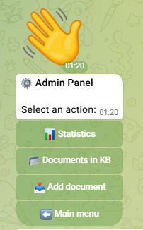
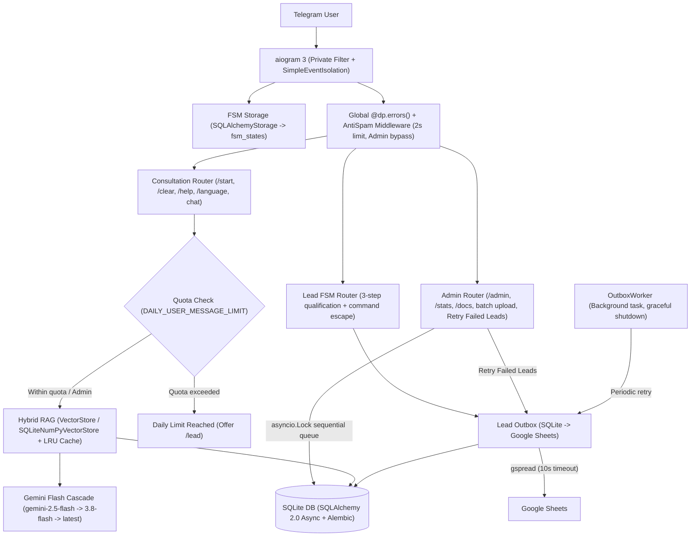

# ai_lead_bot

<div align="center">

[](https://python.org)
[](https://aiogram.dev)
[](https://ai.google.dev)
[](https://www.sqlalchemy.org)
[](https://pytest.org)
[](https://docker.com)
[](LICENSE)

An asynchronous Telegram bot designed for client consultation, automated lead intake, and document-backed question answering. Built with Python 3.11+, aiogram 3.31, Google Gemini Flash, a hybrid vector RAG pipeline, SQLAlchemy 2.0 Async + Alembic, and a transactional Lead Outbox.

[Demo & Screenshots](#demo--screenshots) · [Architecture](#architecture) · [Database & Lead Outbox](#database--transactional-lead-outbox) · [Hybrid Knowledge Base](#hybrid-knowledge-base) · [RAG Engine](#vector-rag-engine) · [Features & Commands](#features) · [Quick Start](#quick-start) · [Testing](#testing--verification) · [Docker](#docker-deployment) · [Configuration](#configuration-reference)

</div>

---

## Overview

This project provides an automated sales and support assistant inside Telegram. Unlike simple prompt-wrapper bots, it implements a hybrid Retrieval-Augmented Generation (RAG) system combining an always-loaded company context (`knowledge_base.txt`) with vectorized PDF/DOCX search, cross-page table preservation, exact page citations, and fallback cascades across Gemini models.

When a client asks about pricing, services, or technical details, the bot references indexed corporate documents (PDF or DOCX). When a user decides to order a service, an interactive finite state machine (FSM) collects contact details, validates inputs, persists the lead locally via a transactional outbox before exporting to Google Sheets, and alerts the administrator.

---

## Demo & Screenshots

### Client Flow: Hybrid RAG & Lead Intake

| Hybrid RAG Consultation | Lead Qualification Form (FSM) |
| :---: | :---: |
|  |  |
| Grounded answers from `knowledge_base.txt` + PDF/DOCX with exact page citations | 3-step validated form with SQLite Lead Outbox UUID & admin alert |

> [!NOTE]
> **Understanding the RAG Consultation Screenshot:**
> The screenshot illustrates **Dynamic Document Priority (RAG Override)**. In this scenario, the administrator uploaded a corporate service catalogue (`Prais_IT_Poslug.pdf`). When the client asked about prices, the bot prioritized the specific corporate pricing from `Prais_IT_Poslug.pdf (p. 2)` ($250, $600, $1200) over the fallback developer rates in `knowledge_base.txt` ($50–$150) and cited the exact document page (`📄 Source: Prais_IT_Poslug.pdf (p. 2)`). When no documents are uploaded, the bot answers directly using `knowledge_base.txt`.

### Admin Control Panel

| Admin Panel | Live Statistics | Indexed Knowledge Base |
| :---: | :---: | :---: |
|  |  |  |

---

## Architecture

The bot is designed to be fully non-blocking. Private-chat routers and `SimpleEventIsolation` serialize concurrent updates per user, while `SQLAlchemyStorage` provides database-backed persistent FSM state management across container restarts. Database queries, vector searches via `SQLiteNumPyVectorStore` (cached L2-normalized matrix adhering to the `VectorStore` protocol), embeddings (backed by an in-memory LRU query cache), model calls, and external Google Sheets writes run asynchronously or inside dedicated thread pools to keep the event loop responsive. Daily message quotas (`DAILY_USER_MESSAGE_LIMIT`) are enforced with admin bypass, a background retry worker (`OutboxWorker`) periodically processes failed leads with graceful shutdown, and unhandled update exceptions are captured by a global `@dp.errors()` boundary.



### Database & Transactional Lead Outbox

All persistent application data — including user language settings, dialogue history, vector embeddings, persistent FSM states, and lead buffers — is stored locally in a single **SQLite** database (`data/chat_history.db`) managed through **SQLAlchemy 2.0 Async** (`aiosqlite`) and versioned with **Alembic** migrations (`alembic/versions/0001_code_first.py` -> `alembic/versions/0002_fsm_states.py`).

No external vector database (such as Pinecone, Qdrant, or Chroma) or separate database server (such as PostgreSQL) is required. High-dimensional vector embeddings are serialized as float32 binary arrays (`LargeBinary`) and stored directly in SQLite alongside document metadata, providing a self-contained, zero-dependency deployment.

- **Connection Pragmas:** Connections are automatically initialized with `PRAGMA journal_mode=WAL` (Write-Ahead Logging for non-blocking concurrent reads and writes) and `PRAGMA foreign_keys=ON` with a 10-second busy timeout.
- **Alembic Code-First Migrations:** `init_db()` executes Alembic upgrades programmatically on bot startup (`command.upgrade(config, "head")`), ensuring tables and constraints match the ORM definitions in [`services/models.py`](services/models.py).

#### SQLite Database Schema (6 Tables)

| Table | ORM Model | Keys & Constraints | Description |
|---|---|---|---|
| `users` | `User` | `user_id` (PK, BigInteger) | Registered Telegram users, language preference (`uk` / `en`), `first_seen`, and `last_active` timestamps. |
| `history` | `History` | `id` (PK), `user_id` (Index), `timestamp` (Index) | Contextual dialogue exchanges (`role`: `'user'` / `'assistant'`, `content`). Kept within `MAX_HISTORY_CHARS` and wiped via `/clear`. |
| `documents` | `Document` | `id` (PK), `filename` (Unique NOCASE) | Metadata of uploaded PDF/DOCX files: `file_type`, `chunk_count`, `embedding_model` (`gemini-embedding-001`), `embedding_dim` (`3072`), `uploaded_at`. |
| `document_chunks` | `DocumentChunk` | `id` (PK), `doc_id` (FK `documents.id` ON DELETE CASCADE) | RAG knowledge chunks: `chunk_index`, `page_number`, `content` (text up to 800 chars), and `embedding` (**LargeBinary BLOB storing float32 NumPy vectors**). |
| `leads` | `Lead` | `id` (PK), `lead_uuid` (Unique), `user_id` (Index), `status` (Index) | Transactional Outbox: `name`, `phone`, `request_text`, `status` (`'pending'`, `'sent'`, `'failed'`), `attempts`, `last_error`, `created_at`, `sent_at`. |
| `fsm_states` | `FSMState` | `key` (PK, String), `updated_at` (Index) | Persistent FSM storage (`SQLAlchemyStorage`): stores user conversation state string (`state`) and JSON-serialized step data (`data`). Survives bot and container restarts. |

#### Transactional Lead Outbox Flow
1. **Persistent FSM State:** State and intermediate inputs during multi-step intake are held in SQLite via `SQLAlchemyStorage`, ensuring surveys survive container restarts or polling dropouts without user disruption.
2. **Idempotent UUID:** Initiating the lead form generates a unique client-side `lead_uuid`.
3. **Local Persistence First:** On form submission, the lead is immediately committed to the SQLite `leads` table with `status='pending'`.
4. **Isolated Sync:** An isolated thread-pool call attempts export to Google Sheets via `gspread` (10-second timeout).
   - On success: transitions to `status='sent'` with `sent_at` recorded.
   - On failure (timeout or network error): transitions to `status='failed'`, records `attempts` and `last_error`. The user still receives confirmation without seeing the internal sync error.
5. **Automated Worker & Admin Recovery:** A background `OutboxWorker` task periodically scans for unsynced leads (`retry_failed_leads()`) at a configurable interval (`OUTBOX_RETRY_INTERVAL_SEC`, default: 300s, up to `OUTBOX_MAX_ATTEMPTS` attempts) and cleanly stops on shutdown. In addition, the inline Admin Panel automatically surfaces the **Retry Failed Leads** (`admin:retry_leads`) button, serialized with an `asyncio.Lock` to safely push pending records without duplicates.

### Hybrid Knowledge Base: Dual-Layer Retrieval Architecture

The bot's consultation intelligence is organized into two distinct layers:

1. **Static Baseline Profile ([`knowledge_base.txt`](knowledge_base.txt)):** Contains the developer's background (Artem, Python/Telegram Bot Developer), work schedule, guarantees, and baseline starting rates ($50 Bot-BizCard, $100 AI Bot, $150 Custom Solution). It is permanently loaded into the system prompt and hot-reloads via an mtime cache whenever edited on disk.
2. **Dynamic Vector Knowledge Base (SQLite `documents` + `document_chunks`):** Corporate PDF/DOCX files uploaded through Telegram by the administrator (e.g., service catalogues or detailed commercial price sheets like `Prais_IT_Poslug.pdf`). Text chunks are vectorized using `gemini-embedding-001` (3072 dim) and stored as binary BLOBs in SQLite.

**Fact Priority Hierarchy:** When an uploaded document contains relevant facts for a user's question, vector search retrieves those chunks, and the prompt instructs Gemini to **prioritize the uploaded document over the static baseline profile**. This is why the demo screenshot displays the corporate rates from `Prais_IT_Poslug.pdf (p. 2)` ($250, $600, $1200) instead of the $50–$150 starting rates. If documents are deleted, the bot immediately falls back to `knowledge_base.txt`.


#### Company Context and Document Facts
- **Always available:** [`knowledge_base.txt`](knowledge_base.txt) provides general service descriptions and any prices or terms recorded there. Its mtime-based cache reloads changes without restarting the bot.
- **Additional retrieval:** When documents exist, queries are embedded and searched with NumPy cosine similarity. Results use the absolute threshold (`score >= 0.52`) and relative window (`score >= max(0.52, top_score - 0.08)`), with at most four fragments.
- **Fact priority:** Relevant document fragments take precedence over company context for exact prices, tariffs, terms, and regulations. General consultation remains available when no fragments match.
- **Strict sources:** Replies based on documents receive an automatically formatted footer such as `📄 Джерело: price.pdf (стор. 2)`. Internal source identifiers are checked against the retrieved fragments; company-only answers do not cite unused documents.
- **Missing information:** `NO_RAG_ANSWER` is used only when the requested specific facts are absent from both sources.
- **Document removal:** `admin:clear_all_docs` displays an inline two-step confirmation (`admin:confirm_clear_all` / `admin:cancel_clear_all`); only confirmed purges delete documents and chunks, invalidate the vector cache, and leave the company context available.

#### Embedding Compatibility
- `EMBEDDING_MODEL` defaults to `gemini-embedding-001`; `EMBEDDING_DIM` defaults to `3072`. Both indexing and query embeddings use these settings.
- Transient request failures retry the same model after 1.5 and 3 seconds. There is no embedding-model fallback.
- Every batch must return exactly one vector per input, with the configured dimension and finite values. Invalid responses abort indexing before any document replacement.
- Documents store their actual model and dimension. Search skips incompatible chunks and logs that the affected documents need reindexing.
- After changing either setting, upload the documents again. Reindex documents created by older versions that could switch embedding models: metadata alone cannot identify vectors previously generated in a different space.

#### Batch Document Ingestion & Concurrency Control
- **Batch Drag-and-Drop:** Administrators can upload multiple `.pdf` and `.docx` files at once directly in the Telegram chat.
- **Anti-Spam Bypass:** `AntiSpamMiddleware` exempts `ADMIN_ID` from the sliding-window rate limit, preventing batch uploads from triggering false-positive flood blocks.
- **Sequential Ingestion Queue (`asyncio.Lock`):** File downloads, parsing, chunk generation, and embedding calls are serialized under an `asyncio.Lock`. This eliminates SQLite write lock errors (`sqlite3.OperationalError: database is locked`), prevents event-loop stalls, and keeps Gemini API embedding rate limits within bounds.

---

## Vector RAG Engine

The RAG subsystem in `services/rag.py` uses `pdfplumber`, `python-docx`, and `numpy`, with SQLAlchemy 2.0 for SQLite storage.

```
Uploaded PDF / DOCX
        │
        ▼
Extract Pages & Preserve Tables
├── PDF: Bounding box filtering masks tables from raw text
└── DOCX: XML page breaks (<w:br>, <w:lastRenderedPageBreak>) + fallback
        │
        ▼
Chunking (800 chars, 150 char overlap)
        │
        ▼
Vector Embeddings (configured model and dimension, strict batch validation)
        │
        ▼
SQLAlchemy Storage (documents + document_chunks with embedding metadata)
        │
        ▼ (Query Time)
Cosine Similarity Matrix Search (NumPy)
Threshold >= 0.52 ──► Top-4 Chunks ──► Gemini Prompt + Page Citations
```

### Table Preservation
Standard parsers flatten tabular data into arbitrary strings, stripping column associations. Here, each table row is extracted into a standalone key-value representation:
```text
[Table Row | Service: Corporate RAG Bot | Duration: 14 days | Price: $1200 | Warranty: 6 months]
```
This preserves column semantics and ensures high cosine similarity matches even on concise user queries.

PDF tables continued on the next page inherit the previous page's last table header when column counts match and the continuation has no header. Headerless two-column tables in PDF and DOCX retain every data row as `Key: Value`. Explicit header labels, bold headers, and DOCX repeated-header metadata are recognized.

Rows longer than `chunk_size` are split with column labels and row context retained. Every resulting chunk respects the size limit, including overlap and newline separators.

### PDF Coordinate Masking
`pdfplumber` normally returns table text twice: once during `extract_text()` and once during `extract_tables()`. To prevent duplication, table bounding boxes (`table.bbox`) are detected first. The page layout is then filtered with `page.filter(...)` to remove table areas before general text extraction runs.

### DOCX Flow Pagination
Word documents do not store fixed page numbers. The parser scans the underlying OpenXML structure for `<w:br w:type="page"/>` and `<w:lastRenderedPageBreak/>` tags. If an uploaded document was authored in a non-Word editor without pagination hints, a deterministic character-count fallback splits content every 1800 characters.

### Refusal Guard and Page Citations
The prompt separates general consultation from exact factual claims:
1. Missing document matches do not prevent an answer from `knowledge_base.txt`.
2. Requested prices, figures, or terms absent from both contexts produce `NO_RAG_ANSWER`.
3. Document-based answers append source references from the selected retrieved fragments:
   ```text
   📄 Джерело: Prais_IT_Poslug.pdf (стор. 2)
   ```

### VectorStore Abstraction & Normalized Matrix Cache (`services/vector_store.py`)
To minimize memory allocations and eliminate repeated norm calculations on every search query, the system decouples vector storage and retrieval via the `VectorStore` protocol:
- **`VectorStore` Protocol:** Defines asynchronous `search(query_vector: np.ndarray, top_k: int = 4, min_score: float = 0.52, score_window: float = 0.08)` and synchronous `invalidate()`.
- **`SQLiteNumPyVectorStore`:** Loads compatible chunks from SQLite, constructs a single contiguous L2-normalized `np.float32` matrix (`N x dim`) and parallel metadata list **once**, and keeps them cached in memory until invalidated by document mutations (`invalidate_chunks_cache()`).
- **Single Matrix-Vector Multiplication:** Searches normalize the incoming query vector once and execute a single matrix-vector product (`matrix @ query_norm`), halving peak memory consumption and accelerating response times.

---

## Features

- **Hybrid Knowledge Base & LRU Query Cache:** Always loads company context from `knowledge_base.txt`, supplements it with relevant document facts, caches up to 128 recent query embeddings in an LRU cache (auto-invalidated on document mutations), and preserves exact citations without disabling general consultation.
- **VectorStore Protocol & Normalized Matrix Cache:** `SQLiteNumPyVectorStore` caches a pre-normalized `(N x dim)` `np.float32` matrix in RAM, executing queries in a single matrix-vector product (`matrix @ query_norm`) without recalculating norms per query. Invalidated automatically on document mutations via `invalidate_chunks_cache()`.
- **Persistent FSM (`SQLAlchemyStorage`):** Replaces volatile in-memory FSM storage with a transactional SQLite storage backend (`fsm_states` table), allowing user form completion to seamlessly survive container restarts, deploys, and network hiccups.
- **Background OutboxWorker:** Scheduled background worker (`services/outbox.py`) automatically retries unsynced or failed leads (`OUTBOX_RETRY_INTERVAL_SEC`, `OUTBOX_MAX_ATTEMPTS`) with graceful shutdown, complementing manual admin retries.
- **Daily Message Quota (`DAILY_USER_MESSAGE_LIMIT`):** Configurable per-user daily message cap (`DAILY_USER_MESSAGE_LIMIT`, default: 30) preventing API token drain. Exceeded quotas prompt users with an inline button to submit a consultation request via `/lead`, while `ADMIN_ID` is permanently exempt.
- **Batch Document Ingestion via Telegram:** Administrators can upload single or batch `.pdf` and `.docx` files simultaneously. An asynchronous ingestion queue (`asyncio.Lock`) serializes parsing, chunking, and embedding generation to avoid event-loop blocking and SQLite write conflicts. Re-uploading an existing filename replaces chunks automatically (`ON DELETE CASCADE`).
- **Resilient Model Cascade & Token Budgets:** The bot executes an automatic 3-tier fallback chain (`gemini-2.5-flash` -> `gemini-3.8-flash` -> `gemini-flash-latest`) with a 1.5-second retry on 503 (Overloaded) or 429 (Rate Limit) errors, while enforcing configurable `MAX_HISTORY_CHARS` and `MAX_OUTPUT_TOKENS` limits.
- **Dialogue Memory & Context Reset (`/clear`):** Maintains up to 8 message exchanges per user (trimmed to `MAX_HISTORY_CHARS`) for contextual follow-up queries. Users can run `/clear` at any time to wipe both in-memory context and stored dialogue history and start fresh.
- **Lead Intake Pipeline, Outbox & Admin Retry:** A 3-step conversation state machine validates client name, phone number (via regex `^\+?[0-9\s\-\(\)]{7,20}$`), and project details, persists leads locally via SQLAlchemy outbox before syncing to Google Sheets, and notifies the admin. Commands `/start`, `/clear`, `/cancel`, `/help`, and `/language` cleanly exit the FSM from any step. Failed syncs can be retried in one tap via the **Retry Failed Leads** button in the Admin Panel.
- **Private-Chat Isolation & Concurrency Safety:** Routers enforce `ChatType.PRIVATE` filtering, and aiogram's `SimpleEventIsolation` prevents race conditions when a user sends overlapping updates.
- **Bilingual Interface:** Supports Ukrainian (`uk`) and English (`en`). User preferences are stored in SQLite. English prompts are tuned for international readability (A2-B1 vocabulary).
- **Anti-Spam Throttling with Admin Exemption:** Sliding-window rate limiter prevents user message flooding (2-second interval) with periodic in-memory cleanup, while bypassing restrictions for `ADMIN_ID` during administration and batch file uploads.
- **Admin Control Panel & Statistics:** Authorized admins (`ADMIN_ID`) get an inline control panel (`⚙️ Адмін-панель` / `/admin`) for one-tap statistics review, knowledge base inspection, document removal, batch intake, **Retry Failed Leads** (`admin:retry_leads`) for unsynced outbox records, and two-step confirmed database purge (`admin:clear_all_docs` -> `admin:confirm_clear_all` / `admin:cancel_clear_all`), alongside `/stats`, `/docs`, and `/del_doc` commands.
- **Error Boundaries & Safe HTML Rendering:** Corrupted PDF/DOCX uploads (`BadZipFile`, broken PDFs) and embedding/LLM API failures always replace or remove temporary status messages ("Indexing…" / "Thinking…"), uncaught update errors are logged with tracebacks by `@dp.errors()`, and all user names, lead fields, and filenames are escaped with `html.escape()`.

### Bot Commands

| Command | Access | Description |
|---|---|---|
| `/start` | User | Greet the user, select language (if first visit), reset any active FSM state, and open the inline menu |
| `/clear` | User | Reset the user's conversation context (clears both in-memory LLM session and SQLite dialogue history) |
| `/help` | User | Show usage instructions and return to the main inline menu |
| `/language` | User | Switch interface and response language (`uk` / `en`) |
| `/cancel` | User | Cancel an active lead qualification form |
| `/admin` | Admin | Open the inline Admin Panel (Statistics, Documents, Upload hint, and **Retry Failed Leads** when failed outbox records exist) |
| `/stats` | Admin | Display total users, dialogues, leads, and document counters |
| `/docs` | Admin | List indexed PDF/DOCX documents with chunk counts and upload dates |
| `/del_doc <filename>` | Admin | Delete an indexed document and its vector chunks by filename |

---

## Tech Stack

| Component | Library / Tool | Role in System |
|---|---|---|
| Language | Python 3.11+ | Type hints (PEP 484, PEP 604), async/await |
| Telegram API | aiogram 3.31 | Asynchronous dispatcher, routers, FSM, filters, and global error boundary |
| AI / LLM | google-genai SDK | Generation via Gemini Flash and embeddings via `gemini-embedding-001` |
| Vector Engine | NumPy, pdfplumber, python-docx | Ingestion, coordinate filtering, cross-page tables, and cosine similarity |
| Database | SQLAlchemy 2.0, Alembic, aiosqlite | Async SQLite ORM, Code-First migrations, RAG storage, and Lead Outbox |
| Lead Export | gspread 6.2 | Service account authentication and timeout-guarded Google Sheets append |
| Testing | pytest, pytest-asyncio | Full test coverage with mocked external dependencies |
| Linting | ruff | Code style and strict PEP 8 compliance |
| Deployment | Docker, Docker Compose | Single-stage slim container (`python:3.11-slim`) with non-root user and persistent volume |

---

## Quick Start

### 1. Requirements
- Python 3.11 or higher
- Telegram Bot token (from [@BotFather](https://t.me/BotFather))
- Google AI Studio API key ([aistudio.google.com](https://aistudio.google.com/))
- Google Cloud Service Account JSON file with Google Sheets API enabled

### 2. Installation

Clone the repository and set up a virtual environment:

```bash
git clone https://github.com/Artem-462/ai_lead_bot.git
cd ai_lead_bot

python -m venv venv

# Windows
venv\Scripts\activate
# Linux / macOS
source venv/bin/activate

pip install -r requirements.txt
pip install -r requirements-dev.txt
```

### 3. Environment Configuration

Copy the sample environment file:

```bash
cp .env.example .env
cp credentials.json.example credentials.json
```

Populate `.env` with your credentials:

```env
BOT_TOKEN=123456789:ABCDefghIJKlmnoPQRstuvwxYZ
GEMINI_API_KEY=AIzaSyYourGeminiApiKeyHere
ADMIN_ID=987654321
GOOGLE_SHEET_NAME=Leads
GEMINI_MODELS=gemini-2.5-flash,gemini-3.8-flash,gemini-flash-latest
EMBEDDING_MODEL=gemini-embedding-001
EMBEDDING_DIM=3072
MAX_HISTORY_CHARS=6000
MAX_OUTPUT_TOKENS=1024
DAILY_USER_MESSAGE_LIMIT=30
OUTBOX_RETRY_INTERVAL_SEC=300
OUTBOX_MAX_ATTEMPTS=5
```

Place your Google Cloud Service Account JSON inside `credentials.json`. Share your target Google Sheet with the `client_email` specified in your service account credentials.

### 4. Running the Bot

```bash
python main.py
```

---

## Testing & Verification

The test suite covers unit and integration behavior across all subsystems. All external network calls (Telegram Bot API, Gemini API, Google Sheets) are mocked.

```bash
# Run unit tests
python -m pytest tests -v

# Run real integration tests (without aiogram stubs)
python -m pytest tests_integration -v

# Run linter
python -m ruff check .
```

### Test Breakdown

| File | Tests | Validated Behavior |
|---|---:|---|
| `tests/test_rag.py` | 112 | Batch count and dimension validation, same-model retry, embedding compatibility, LRU query embedding cache, PDF continuation headers, key-value tables, bounded table chunks, `VectorStore` protocol conformance & caching, document handlers |
| `tests/test_handlers.py` | 105 | FSM validation and command escape, authorization, HTML escaping, Lead Outbox persistence, admin `Retry Failed Leads`, admin language notifications, 2-step RAG clear confirmation, corrupt file error handling, batch uploads |
| `tests/test_db.py` | 84 | Code-First ORM schema, Alembic migrations (`0001_code_first` -> `0002_fsm_states`), conversation history & `/clear` cleanup, document transactions, chunk cache, Lead Outbox queries, failed-lead retries, daily message counting |
| `tests/test_llm.py` | 64 | Hybrid company/document context, contextual search queries, `MAX_HISTORY_CHARS` & `MAX_OUTPUT_TOKENS` budgets, missing facts, exact citations, generation retries, `BASE_ANSWER`/`SOURCES` marker stripping, fallback |
| `tests/test_main.py` | 38 | Command routing, `/clear` history reset, private-chat filter, `SimpleEventIsolation`, FSM reset on `/start`/`/help`/`/language`/`/clear`, HTML name escaping, AI error boundary, `@dp.errors()`, inline callbacks, daily quota throttling & admin bypass |
| `tests/test_i18n.py` | 29 | Symmetric Ukrainian/English keys and placeholders, language switching, template formatting, admin notifications |
| `tests/test_fsm_storage.py` | 10 | `SQLAlchemyStorage` key generation, state and data CRUD operations, JSON serialization, automatic DB cleanup upon FSM reset |
| `tests/test_config.py` | 9 | Model cascade configuration, outbox retry parameters, non-negative daily quota validation, environment parsing |
| `tests/test_outbox.py` | 5 | `retry_failed_leads` logic, max attempts filtering, `OutboxWorker` background loop and graceful shutdown |
| `tests_integration/test_real_pipeline.py` | 4 | End-to-end integration without aiogram stubs: FSM restart survival across fresh Dispatcher instances, Lead Outbox recovery upon Sheets restoration, daily quota blocking & admin bypass, and `SQLiteNumPyVectorStore` DB index/search/delete roundtrip |
| **Total** | **460** | **100% passing (456 unit + 4 real integration tests)** |

---

## Docker Deployment

A single-stage slim Docker build (`python:3.11-slim`, running as non-root `botuser`) is provided for deployment on Linux VPS instances.

### Launching with Docker Compose

```bash
# Clone and enter directory
git clone https://github.com/Artem-462/ai_lead_bot.git
cd ai_lead_bot

# Set up credentials
cp .env.example .env
# Edit .env and copy credentials.json into the directory

# Build and start container in background
docker compose up -d --build
```

### Useful Commands

```bash
# Check service logs
docker compose logs -f bot

# Restart the application
docker compose restart bot

# Stop container
docker compose down
```

SQLite files and indexed embeddings are preserved in the persistent volume mapped to `/app/data/`.

- **Log rotation:** `docker-compose.yml` configures Docker's `json-file` logging driver with `max-size: "10m"` and `max-file: "3"` to cap disk usage on long-running servers.
- **Healthcheck:** `Dockerfile` defines a `HEALTHCHECK` that validates application configuration, core module imports, and write access to `/app/data`.

---

## Configuration Reference

| Parameter | Type | Required | Description |
|---|---|---|---|
| `BOT_TOKEN` | string | Yes | Telegram Bot API token |
| `GEMINI_API_KEY` | string | Yes | Google AI Studio access key |
| `ADMIN_ID` | integer | No | Telegram ID allowed to execute `/admin`, `/stats`, `/docs`, `/del_doc`, and retry failed leads |
| `GOOGLE_SHEET_NAME` | string | No | Google Sheet worksheet title (default: `Leads`) |
| `GEMINI_MODELS` | string | No | Comma-separated list of Gemini model names in order of priority |
| `EMBEDDING_MODEL` | string | No | Single model for the vector index (default: `gemini-embedding-001`); changes require reindexing |
| `EMBEDDING_DIM` | integer | No | Requested and validated vector dimension (default: `3072`); changes require reindexing |
| `MAX_HISTORY_CHARS` | integer | No | Maximum total characters retained in per-user conversation history sent to Gemini (default: `6000`) |
| `MAX_OUTPUT_TOKENS` | integer | No | Maximum output tokens generated per Gemini response (default: `1024`) |
| `DAILY_USER_MESSAGE_LIMIT` | integer | No | Maximum user messages allowed per calendar day (default: `30`; `0` disables limit, `ADMIN_ID` is exempt) |
| `OUTBOX_RETRY_INTERVAL_SEC` | integer | No | Interval in seconds between background OutboxWorker retry cycles (default: `300`) |
| `OUTBOX_MAX_ATTEMPTS` | integer | No | Maximum retry attempts for failed leads before requiring manual intervention (default: `5`) |

---

## Project Layout

```text
ai_lead_bot/
├── main.py                     # Entry point, private-chat filter, SimpleEventIsolation, /clear, @dp.errors()
├── config.py                   # Environment validation (token limits, outbox retries, daily quota)
├── i18n.py                     # Localization strings and helper functions
├── keyboards.py                # InlineKeyboardMarkup builders (incl. 2-step clear & Retry Failed Leads)
├── knowledge_base.txt          # Always-loaded company context with hot-reload
├── alembic.ini                 # Alembic migration configuration
├── requirements.txt            # Runtime dependencies
├── requirements-dev.txt        # Development and testing dependencies
├── pytest.ini                  # Pytest configuration
├── Dockerfile                  # Slim single-stage container build (non-root user + HEALTHCHECK)
├── docker-compose.yml          # Container configuration, JSON log rotation, and persistent volume
│
├── alembic/
│   ├── env.py                  # Async Alembic environment bound to services.models.Base
│   └── versions/
│       ├── 0001_code_first.py  # Initial Code-First schema and legacy upgrade migration
│       └── 0002_fsm_states.py  # Persistent FSMState table migration
│
├── docs/
│   └── screenshots/            # UI demo screenshots (rag_answer.jpg, lead_form.jpg, admin_panel.png, admin_stats.png, admin_docs.png)
│
├── handlers/
│   ├── admin.py                # /admin, /stats, /docs, /del_doc, Retry Failed Leads, 2-step clear, batch intake
│   └── lead_form.py            # 3-step lead qualification FSM with Lead Outbox sync
│
├── services/
│   ├── models.py               # SQLAlchemy 2.0 ORM models (User, History, Document, Chunk, Lead, FSMState)
│   ├── db.py                   # Async SQLAlchemy 2.0 DB layer, Alembic init, and Lead Outbox queries
│   ├── fsm_storage.py          # SQLAlchemyStorage persistent FSM storage for aiogram
│   ├── llm.py                  # Hybrid context, token budgets, citations, Gemini cascade, and retries
│   ├── outbox.py               # OutboxWorker background retry loop and retry_failed_leads
│   ├── rag.py                  # Vector indexing, LRU query cache, cross-page tables, and cosine search
│   ├── sheets.py               # Timeout-guarded Google Sheets append integration
│   └── vector_store.py         # VectorStore protocol & SQLiteNumPyVectorStore normalized matrix cache
│
├── middlewares/
│   └── antispam.py             # Rate-limiting middleware (sliding window + admin bypass)
│
├── data/                       # Local SQLite storage directory
│   └── chat_history.db
│
├── tests/                      # Automated unit test suite (456 tests)
│   ├── conftest.py
│   ├── test_config.py
│   ├── test_db.py
│   ├── test_fsm_storage.py
│   ├── test_handlers.py
│   ├── test_i18n.py
│   ├── test_llm.py
│   ├── test_main.py
│   ├── test_outbox.py
│   └── test_rag.py
│
└── tests_integration/          # Real integration test suite without aiogram stubs (4 tests)
    ├── conftest.py
    └── test_real_pipeline.py
```

---

## Security

- Secrets (`.env`, `credentials.json`) are strictly excluded from version control via `.gitignore` and `.dockerignore`.
- The container image executes as an unprivileged user (`botuser`).
- Admin endpoints (`/admin`, `/stats`, `/docs`, `/del_doc`, admin callbacks) verify incoming user IDs against `ADMIN_ID`, and clearing the entire RAG database requires explicit two-step confirmation.
- User names (`first_name`), lead form inputs, and document filenames are escaped via `html.escape()` before rendering in Telegram HTML messages.
- Incoming document uploads are restricted to `.pdf` and `.docx` extensions (max 20 MB) with validation and error-safe status cleanup prior to storage.

---

## License

This project is licensed under the [MIT License](LICENSE).
