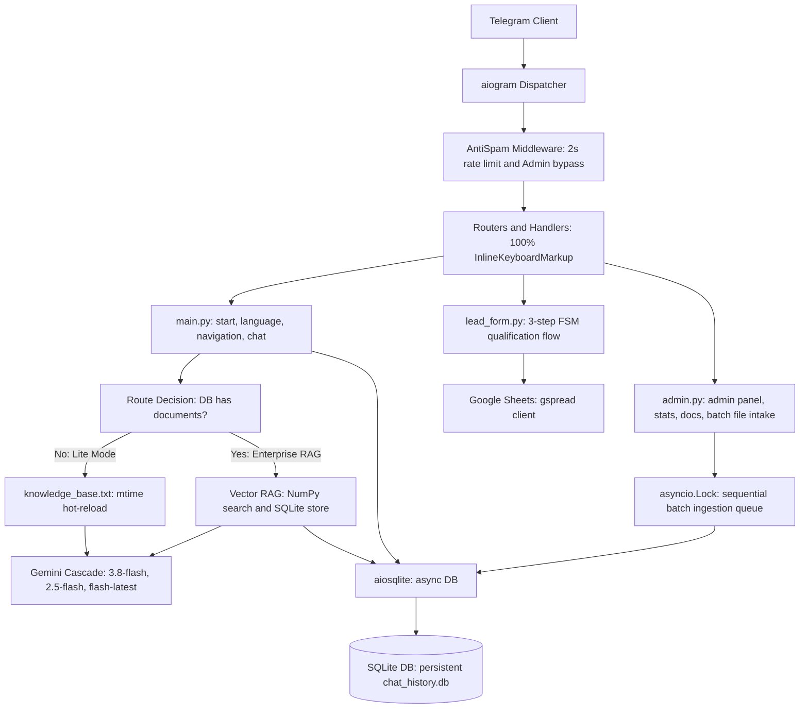
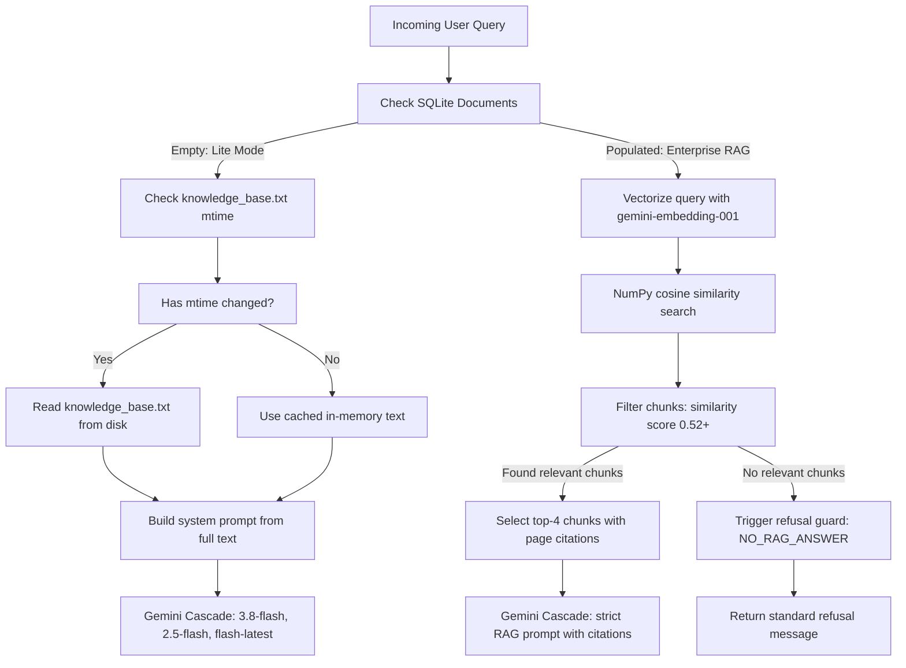

# ai_lead_bot

<div align="center">

[](https://python.org)
[](https://aiogram.dev)
[](https://ai.google.dev)
[](https://github.com/omnilib/aiosqlite)
[](https://pytest.org)
[](https://docker.com)
[](LICENSE)

An asynchronous Telegram bot designed for client consultation, automated lead intake, and document-backed question answering. Built with Python 3.11, aiogram 3.31, Google Gemini Flash, a custom vector RAG pipeline, and SQLite.

[Architecture](#architecture) · [Dual-Mode Engine](#dual-mode-knowledge-base-architecture) · [RAG Engine](#vector-rag-engine) · [Features](#features) · [Quick Start](#quick-start) · [Testing](#testing--verification) · [Docker](#docker-deployment) · [Configuration](#configuration)

</div>

---

## Overview

This project provides an automated sales and support assistant inside Telegram. Unlike simple prompt-wrapper bots, it implements a full Retrieval-Augmented Generation (RAG) system with vectorized document search, table preservation, exact page citations, and fallback cascades across Gemini models.

When a client asks about pricing, services, or technical details, the bot references indexed corporate documents (PDF or DOCX). When a user decides to order a service, an interactive finite state machine (FSM) collects contact details, validates inputs, exports the record to Google Sheets, and alerts the administrator.

---

## Architecture

The bot is designed to be fully non-blocking. Database queries, embeddings, model calls, and external Google Sheets writes run asynchronously or inside dedicated thread pools to keep the event loop responsive.



### Dual-Mode Knowledge Base Architecture

The bot provides a 2-in-1 knowledge base architecture, adapting its retrieval and prompt construction strategy to the operational scale of the deployment:



#### 1. Lite Mode (Small Business)
- **Target deployment:** Freelancers, solo developers, and small service businesses maintaining a compact list of services, prices, and terms in a single document.
- **Data source:** Flat text file [`knowledge_base.txt`](knowledge_base.txt).
- **Zero-downtime hot-reload:** The runtime checks the file modification timestamp (`os.path.getmtime`) on each incoming user question. If the file is modified on disk, the in-memory string cache updates on the fly without restarting the service or dropping active Telegram sessions.
- **Default activation:** Engages automatically whenever the SQLite document tables contain zero records.

#### 2. Enterprise RAG Mode (Large Companies)
- **Target deployment:** Companies with structured catalogs, service-level agreements, technical specifications, and multi-page price lists across multiple corporate documents.
- **Automatic activation:** Automatically triggers as soon as an administrator uploads one or more `.pdf` or `.docx` files.
- **Vector search pipeline:** Incoming queries are vectorized using `gemini-embedding-001`, evaluated against in-memory chunk embeddings using NumPy cosine similarity, and filtered by similarity threshold (`score >= 0.52`).
- **Structure preservation and citations:** Preserves table rows (`[Table Row | ...]`), uses coordinate masking in PDF to prevent duplicate extraction, and deterministically formats page numbers and source filenames in the reply footer (e.g. `📄 Джерело: price.pdf (стор. 2)`).
- **Refusal guard:** If retrieved chunks fail to reach the threshold or lack the factual answer, the LLM emits `NO_RAG_ANSWER` and the bot delivers a polite factual refusal instead of hallucinating.

#### 3. Instant Rollback (`admin:clear_all_docs`)
- Administrators can wipe the vector store in a single click using the `admin:clear_all_docs` button inside the inline admin panel.
- Purging drops all records in `documents` and `document_chunks` (`ON DELETE CASCADE`), invalidates the chunk embedding cache, and immediately rolls the consultation pipeline back to Lite Mode (`knowledge_base.txt`) without server restarts.

#### 4. Batch Document Ingestion & Concurrency Control
- **Batch Drag-and-Drop:** Administrators can upload multiple `.pdf` and `.docx` files at once directly in the Telegram chat.
- **Anti-Spam Bypass:** `AntiSpamMiddleware` exempts `ADMIN_ID` from the sliding-window rate limit, preventing batch uploads from triggering false-positive flood blocks.
- **Sequential Ingestion Queue (`asyncio.Lock`):** File downloads, parsing, chunk generation, and embedding calls are serialized under an `asyncio.Lock`. This eliminates SQLite write lock errors (`sqlite3.OperationalError: database is locked`), prevents event-loop stalls, and keeps Gemini API embedding rate limits within bounds.

---

## Vector RAG Engine

Rather than relying on heavy third-party frameworks like LangChain or LlamaIndex, the RAG subsystem in `services/rag.py` is implemented directly using `pdfplumber`, `python-docx`, `numpy`, and `aiosqlite`.

```
Uploaded PDF / DOCX
        │
        ▼
Extract Pages & Preserve Tables
├── PDF: Bounding box filtering masks tables from raw text
└── DOCX: XML page breaks (<w:br>, <w:lastRenderedPageBreak>) + fallback
        │
        ▼
Chunking (800 chars, 150 char overlap)
        │
        ▼
Vector Embeddings (gemini-embedding-001)
        │
        ▼
aiosqlite Storage (documents + document_chunks tables)
        │
        ▼ (Query Time)
Cosine Similarity Matrix Search (NumPy)
Threshold >= 0.52 ──► Top-4 Chunks ──► Gemini Prompt + Page Citations
```

### Table Preservation
Standard parsers flatten tabular data into arbitrary strings, stripping column associations. Here, each table row is extracted into a standalone key-value representation:
```text
[Table Row | Service: Corporate RAG Bot | Duration: 14 days | Price: $1200 | Warranty: 6 months]
```
This preserves column semantics and ensures high cosine similarity matches even on concise user queries.

### PDF Coordinate Masking
`pdfplumber` normally returns table text twice: once during `extract_text()` and once during `extract_tables()`. To prevent duplication, table bounding boxes (`table.bbox`) are detected first. The page layout is then filtered with `page.filter(...)` to remove table areas before general text extraction runs.

### DOCX Flow Pagination
Word documents do not store fixed page numbers. The parser scans the underlying OpenXML structure for `<w:br w:type="page"/>` and `<w:lastRenderedPageBreak/>` tags. If an uploaded document was authored in a non-Word editor without pagination hints, a deterministic character-count fallback splits content every 1800 characters.

### Refusal Guard and Page Citations
To eliminate hallucinations:
1. If no chunk reaches the similarity threshold of `0.52`, the bot answers directly with a polite refusal without wasting LLM tokens.
2. The LLM prompt instructs the model to reply with `NO_RAG_ANSWER` if the retrieved text lacks the answer.
3. Successful answers automatically append deterministic source references:
   ```text
   📄 Джерело: Prais_IT_Poslug.pdf (стор. 2)
   ```

---

## Features

- **Dual-Mode Knowledge Base (2-in-1 Architecture):** Dynamically toggles between Lite Mode (flat `knowledge_base.txt` with mtime-based hot-reload without restarts) and Enterprise RAG Mode (vector search over indexed `.pdf`/`.docx` files). Flushing the vector index via `admin:clear_all_docs` reverts the bot to Lite Mode instantly.
- **Batch Document Ingestion via Telegram:** Administrators can upload single or batch `.pdf` and `.docx` files simultaneously. An asynchronous ingestion queue (`asyncio.Lock`) serializes parsing, chunking, and embedding generation to avoid event-loop blocking and SQLite write conflicts. Re-uploading an existing filename replaces chunks automatically (`ON DELETE CASCADE`).
- **Resilient Model Cascade:** The bot executes an automatic 3-tier fallback chain (`gemini-3.8-flash` -> `gemini-2.5-flash` -> `gemini-flash-latest`) with a 1.5-second retry on 503 (Overloaded) or 429 (Rate Limit) errors.
- **Dialogue Memory:** Maintains the last 8 message exchanges per user session to support natural follow-up questions.
- **Lead Intake Pipeline:** A 3-step conversation state machine validates client name, phone number (via regex `^\+?[0-9\s\-\(\)]{7,20}$`), and project details before syncing to Google Sheets and pinging the admin.
- **Bilingual Interface:** Supports Ukrainian (`uk`) and English (`en`). User preferences are stored in SQLite. English prompts are tuned for international readability (A2-B1 vocabulary).
- **Anti-Spam Throttling with Admin Exemption:** Sliding-window rate limiter prevents user message flooding (2-second interval) with periodic in-memory cleanup, while bypassing restrictions for `ADMIN_ID` during administration and batch file uploads.
- **Admin Control Panel & Statistics:** Authorized admins (`ADMIN_ID`) get an inline control panel (`⚙️ Адмін-панель` / `/admin`) for one-tap statistics review, knowledge base inspection, document removal, batch intake, and one-click database purge (`admin:clear_all_docs`), alongside `/stats`, `/docs`, and `/del_doc` commands.

---

## Tech Stack

| Component | Library / Tool | Role in System |
|---|---|---|
| Language | Python 3.11+ | Type hints (PEP 484, PEP 604), structural pattern matching |
| Telegram API | aiogram 3.31 | Asynchronous dispatcher, routers, FSM, and filters |
| AI / LLM | google-genai SDK | Generation via Gemini Flash and embeddings via `gemini-embedding-001` |
| Vector Engine | NumPy, pdfplumber, python-docx | Ingestion, coordinate filtering, and vectorized cosine similarity |
| Database | aiosqlite 0.21 | Async local storage for dialog history, user preferences, and chunks |
| Lead Export | gspread 6.1 | Service account authentication and real-time Google Sheets append |
| Testing | pytest, pytest-asyncio | Full test coverage with mocked external dependencies |
| Linting | ruff | Code style and strict PEP 8 compliance |
| Deployment | Docker, Docker Compose | Multi-stage build with non-root user and persistent volume mount |

---

## Quick Start

### 1. Requirements
- Python 3.11 or higher
- Telegram Bot token (from [@BotFather](https://t.me/BotFather))
- Google AI Studio API key ([aistudio.google.com](https://aistudio.google.com/))
- Google Cloud Service Account JSON file with Google Sheets API enabled

### 2. Installation

Clone the repository and set up a virtual environment:

```bash
git clone https://github.com/Artem-462/ai_lead_bot.git
cd ai_lead_bot

python -m venv venv

# Windows
venv\Scripts\activate
# Linux / macOS
source venv/bin/activate

pip install -r requirements.txt
pip install -r requirements-dev.txt
```

### 3. Environment Configuration

Copy the sample environment file:

```bash
cp .env.example .env
cp credentials.json.example credentials.json
```

Populate `.env` with your credentials:

```env
BOT_TOKEN=123456789:ABCDefghIJKlmnoPQRstuvwxYZ
GEMINI_API_KEY=AIzaSyYourGeminiApiKeyHere
ADMIN_ID=987654321
GOOGLE_SHEET_NAME=Leads
GEMINI_MODELS=gemini-3.8-flash,gemini-2.5-flash,gemini-flash-latest
```

Place your Google Cloud Service Account JSON inside `credentials.json`. Share your target Google Sheet with the `client_email` specified in your service account credentials.

### 4. Running the Bot

```bash
python main.py
```

---

## Testing & Verification

The test suite covers unit and integration behavior across all subsystems. All external network calls (Telegram Bot API, Gemini API, Google Sheets) are mocked.

```bash
# Run all tests
python -m pytest

# Run with verbose output
python -m pytest -v

# Run linter
python -m ruff check .
```

### Test Breakdown

| File | Tests | Validated Behavior |
|---|---|---|
| `tests/test_rag.py` | 24 | PDF table bounding boxes, DOCX XML page breaks, chunking, cosine similarity, `/docs` and `/del_doc` handlers, empty PDF and file size limit |
| `tests/test_handlers.py` | 69 | FSM states, name/phone validation, admin authorization, cancel actions, HTML escaping, admin panel callbacks, clear-all-docs callback |
| `tests/test_llm.py` | 28 | Model cascade fallback, 1.5s retry logic, prompt sanitization, context window limits, 404 fast fallback |
| `tests/test_db.py` | 27 | Schema creation, conversation history logging, daily statistics calculation, document upsert, deletion, and clear_all_documents |
| `tests/test_i18n.py` | 24 | Symmetric Ukrainian/English keys, language switching, template formatting |
| `tests/test_main.py` | 16 | Command routing, router registration order, inline callbacks, rate limiter middleware with admin exemption |
| **Total** | **188** | **100% pass rate** |

---

## Docker Deployment

A multi-stage Docker build is provided for deployment on Linux VPS instances.

### Launching with Docker Compose

```bash
# Clone and enter directory
git clone https://github.com/Artem-462/ai_lead_bot.git
cd ai_lead_bot

# Set up credentials
cp .env.example .env
# Edit .env and copy credentials.json into the directory

# Build and start container in background
docker compose up -d --build
```

### Useful Commands

```bash
# Check service logs
docker compose logs -f bot

# Restart the application
docker compose restart bot

# Stop container
docker compose down
```

SQLite files and indexed embeddings are preserved in the persistent volume mapped to `/app/data/`.

---

## Configuration Reference

| Parameter | Type | Required | Description |
|---|---|---|---|
| `BOT_TOKEN` | string | Yes | Telegram Bot API token |
| `GEMINI_API_KEY` | string | Yes | Google AI Studio access key |
| `ADMIN_ID` | integer | No | Telegram ID allowed to execute `/stats`, `/docs`, `/del_doc` |
| `GOOGLE_SHEET_NAME` | string | No | Google Sheet worksheet title (default: `Leads`) |
| `GEMINI_MODELS` | string | No | Comma-separated list of Gemini model names in order of priority |

---

## Project Layout

```text
ai_lead_bot/
├── main.py                     # Entry point, router setup, and polling
├── config.py                   # Environment validation and logging setup
├── i18n.py                     # Localization strings and helper functions
├── keyboards.py                # InlineKeyboardMarkup builders
├── knowledge_base.txt          # Default text knowledge base (Lite Mode hot-reload)
├── requirements.txt            # Runtime dependencies
├── requirements-dev.txt        # Development and testing dependencies
├── pytest.ini                  # Pytest configuration
├── Dockerfile                  # Multi-stage production container build
├── docker-compose.yml          # Container configuration and persistent volume
│
├── handlers/
│   ├── admin.py                # Commands: /stats, /docs, /del_doc, batch file intake, clear all
│   └── lead_form.py            # 3-step lead qualification FSM
│
├── services/
│   ├── db.py                   # Async SQLite database layer (dialogs, chunks, clear_all)
│   ├── llm.py                  # Dual-mode switch, Gemini cascade, retries, and markdown cleaning
│   ├── rag.py                  # Vector indexing, coordinate filtering, and cosine search
│   └── sheets.py               # Google Sheets append integration
│
├── middlewares/
│   └── antispam.py             # Rate-limiting middleware (sliding window + admin bypass)
│
├── data/                       # Local SQLite storage directory
│   └── chat_history.db
│
└── tests/                      # Automated test suite (188 tests)
    ├── conftest.py
    ├── test_db.py
    ├── test_handlers.py
    ├── test_i18n.py
    ├── test_llm.py
    ├── test_main.py
    └── test_rag.py
```

---

## Security

- Secrets (`.env`, `credentials.json`) are strictly excluded from version control via `.gitignore` and `.dockerignore`.
- The container image executes as an unprivileged user (`botuser`, UID 10001).
- Admin endpoints (`/stats`, `/docs`, `/del_doc`) check incoming user IDs against `ADMIN_ID`.
- Incoming document uploads are restricted to `.pdf` and `.docx` extensions with validation prior to storage.

---

## License

This project is licensed under the [MIT License](LICENSE).
