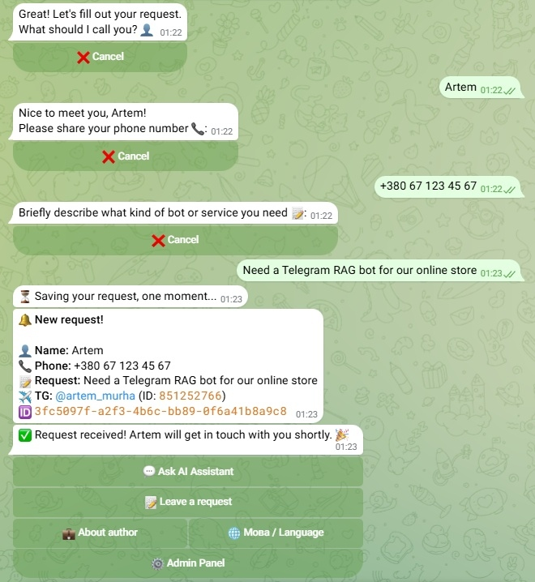
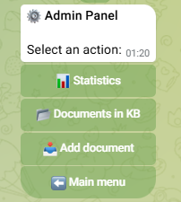
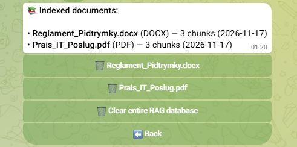
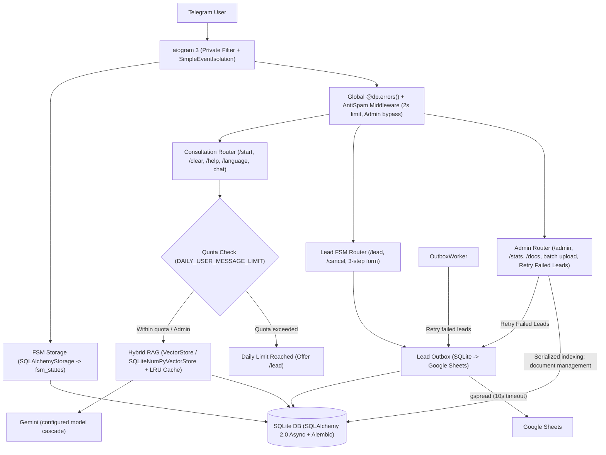
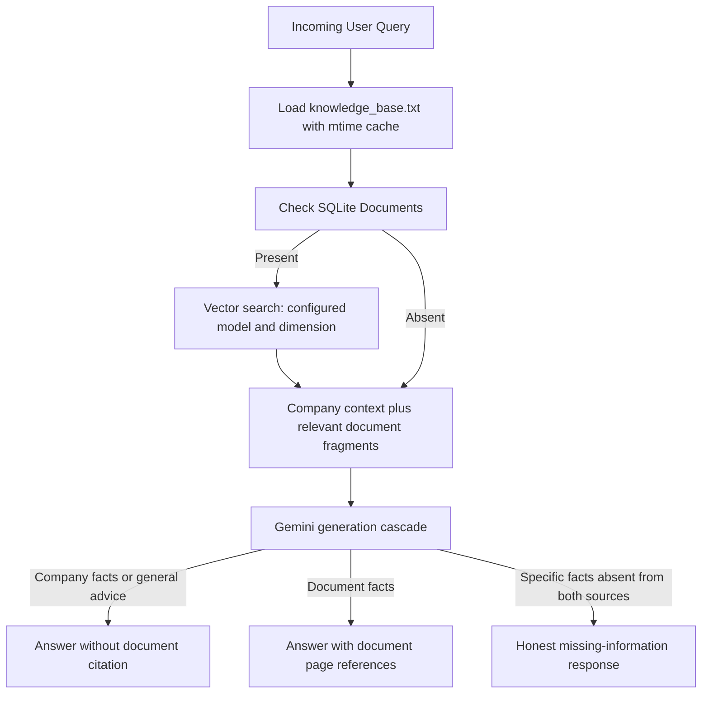

# ai_lead_bot

<div align="center">

[](https://python.org)
[](https://aiogram.dev)
[](https://ai.google.dev)
[](https://www.sqlalchemy.org)
[](https://pytest.org)
[](https://docker.com)
[](LICENSE)

A Telegram bot for service consultations and lead intake. Uses aiogram, Gemini, PDF/DOCX retrieval, and SQLite; exports leads to Google Sheets.

[Demo & Screenshots](#demo--screenshots) · [Architecture](#architecture) · [Database & Lead Outbox](#database--transactional-lead-outbox) · [Hybrid Knowledge Base](#hybrid-knowledge-base) · [RAG Engine](#vector-rag-engine) · [Features & Commands](#features) · [Quick Start](#quick-start) · [Testing](#testing--verification) · [Docker](#docker-deployment) · [Configuration](#configuration-reference)

</div>

---

## Overview

The bot answers from `knowledge_base.txt` and relevant fragments of documents uploaded by the administrator. Document-backed replies include filenames and page references. The three-step lead form collects a name, phone number, and request, saves them in SQLite before export, and notifies the administrator.

---

## Demo & Screenshots

### Client Flow: Hybrid RAG & Lead Intake

| Hybrid RAG Consultation | Lead Qualification Form (FSM) |
| :---: | :---: |
|  |  |
| Company context and retrieved document facts with page references | Three-step form, local lead UUID, and admin notification |

> [!NOTE]
> The pricing reply uses `Prais_IT_Poslug.pdf` (p. 2), whose rates take priority over the baseline in `knowledge_base.txt`. The lead screenshot uses a fictional phone number and the author's public Telegram contact.

### Admin Control Panel

| Admin Panel | Live Statistics | Indexed Knowledge Base |
| :---: | :---: | :---: |
|  |  |  |

---

## Architecture

Private-chat routers handle consultations, lead forms, and admin actions. `SimpleEventIsolation` serializes updates per user within one process; `SQLAlchemyStorage` persists FSM state and form data across restarts. SQLite access and Gemini calls are asynchronous. PDF/DOCX parsing, chunking, and Google Sheets writes use `asyncio.to_thread()`. NumPy matrix loading and search, and knowledge-base file reads, run in the event-loop thread. `OutboxWorker` retries failed exports, and `@dp.errors()` logs unhandled update exceptions.



### Database & Transactional Lead Outbox

Persistent application data is stored in `data/chat_history.db` through SQLAlchemy's async SQLite backend (`aiosqlite`). `init_db()` applies Alembic migrations on startup: `0001_code_first` followed by `0002_fsm_states`.

Embeddings are float32 arrays stored as SQLite BLOBs alongside document metadata. This is a self-contained SQLite deployment without external DB servers. Telegram, Gemini, and Google Sheets still require network access.

- Connections enable `PRAGMA journal_mode=WAL` and `PRAGMA foreign_keys=ON`, with a 10-second busy timeout. WAL allows readers alongside a writer; SQLite still permits only one writer at a time.
- ORM definitions are in [`services/models.py`](services/models.py); schema changes require migrations in `alembic/versions/`.

#### SQLite Database Schema (6 Application Tables)

Alembic also maintains `alembic_version`; SQLite maintains `sqlite_sequence` for autoincrement IDs.

| Table | ORM Model | Keys & Constraints | Description |
|---|---|---|---|
| `users` | `User` | `user_id` (PK, BigInteger) | Telegram ID, optional `username`, language (`uk` / `en`), `first_seen`, and `last_active`. |
| `history` | `History` | `id` (PK), `user_id` (Index), `timestamp` (Index) | Logged exchanges (`role`: `user` / `assistant`, `content`). No automatic retention limit; `/clear` deletes the user's rows. |
| `documents` | `Document` | `id` (PK), `filename` (Unique NOCASE) | Metadata of uploaded PDF/DOCX files: `file_type`, `chunk_count`, `embedding_model` (`gemini-embedding-001`), `embedding_dim` (`3072`), `uploaded_at`. |
| `document_chunks` | `DocumentChunk` | `id` (PK), `doc_id` (Index, FK `documents.id` ON DELETE CASCADE) | `chunk_index`, `page_number`, `content` (default chunk size: 800 chars), and float32 `embedding` BLOB. |
| `leads` | `Lead` | `id` (PK), `lead_uuid` (Unique), `user_id` (Index), `status` (Index) | Transactional Outbox: `name`, `phone`, `request_text`, `status` (`'pending'`, `'sent'`, `'failed'`), `attempts`, `last_error`, `created_at`, `sent_at`. |
| `fsm_states` | `FSMState` | `storage_key` (PK, String) | `state`, JSON-serialized form data (`data_json`), and `updated_at`. The migration does not create an `updated_at` index. |

#### Transactional Lead Outbox Flow
1. Starting a form generates a server-side `lead_uuid`, stored with intermediate answers by `SQLAlchemyStorage`.
2. Submission commits a `pending` lead to SQLite. The unique UUID makes local insertion idempotent.
3. The handler attempts a Google Sheets append in a thread, with a 10-second async timeout and a 10-second gspread request timeout. It writes `[name, phone, request]` to the spreadsheet's first worksheet using `RAW` input.
4. Success sets `sent` and `sent_at`; failure sets `failed` and `last_error`. Both increment `attempts`. A Sheets failure does not prevent confirmation of the locally saved lead.
5. `OutboxWorker` runs a retry cycle immediately, then sleeps for `OUTBOX_RETRY_INTERVAL_SEC` (default: 300s). It selects only `failed` leads whose `attempts < OUTBOX_MAX_ATTEMPTS` (default: 5, including the initial export attempt). Shutdown cancels and awaits its task.
6. The admin retry button appears when failed leads exist. Manual retries ignore the attempt cap and share an in-process `asyncio.Lock` with the worker.

**Limits:** `pending` leads left by interrupted submissions are not recovered by the worker or admin retry button. Sheets appends are not deduplicated by UUID; a timed-out thread may still complete, so retries can create duplicate rows. The retry lock is not a cross-process lock.

`SQLAlchemyStorage` keys combine bot, chat, user, thread, and destiny. State and data are written in separate transactions; a row is removed once both state and data are empty. `close()` does not dispose the shared database engine.

### Hybrid Knowledge Base

`knowledge_base.txt` supplies company context on every request. An mtime cache reloads it after edits. Admin-uploaded PDF/DOCX documents add retrieved facts; the prompt gives relevant document facts priority over the company context.



#### Company Context and Document Facts
- **Additional retrieval:** When documents exist, queries are embedded and searched with NumPy cosine similarity. Results use the absolute threshold (`score >= 0.52`) and relative window (`score >= max(0.52, top_score - 0.08)`), with at most four fragments.
- **Sources:** Replies receive a footer such as `📄 Джерело: price.pdf (стор. 2)`. `DOCUMENT_ANSWER` identifiers are checked against retrieved fragments; `BASE_ANSWER` suppresses document citations. Invalid identifiers are discarded. If no source marker is returned, all retrieved fragments are cited. This validates references, not the factual accuracy of the answer.
- **Missing information:** The prompt requests `NO_RAG_ANSWER` when specific facts are absent from both sources; the handler converts that marker to a localized refusal.
- **Document removal:** `admin:clear_all_docs` displays an inline two-step confirmation (`admin:confirm_clear_all` / `admin:cancel_clear_all`); only confirmed purges delete documents and chunks, invalidate the vector cache, and leave the company context available.

#### Embedding Compatibility
- `EMBEDDING_MODEL` defaults to `gemini-embedding-001`; `EMBEDDING_DIM` defaults to `3072`. Both indexing and query embeddings use these settings.
- Transient request failures retry the same model after 1.5 and 3 seconds. There is no embedding-model fallback.
- Every batch must return exactly one vector per input, with the configured dimension and finite values. Invalid responses abort indexing before any document replacement.
- Documents store their actual model and dimension. Search skips incompatible chunks and logs that the affected documents need reindexing.
- After changing either setting, upload the documents again. Reindex documents created by older versions that could switch embedding models: metadata alone cannot identify vectors previously generated in a different space.

#### Document Ingestion
Admins can send one or several PDF/DOCX files in Telegram. Downloads occur before the indexing lock; parsing, chunking, embedding requests, and storage are serialized by `asyncio.Lock`. This reduces overlapping indexing work but does not guarantee freedom from SQLite contention or Gemini rate limits. Uploading the same filename replaces the document and chunks in one transaction; filename matching is case-insensitive.

---

## Vector RAG Engine

[`services/rag.py`](services/rag.py) handles parsing, chunking, and embeddings; [`services/vector_store.py`](services/vector_store.py) handles vector search.

Default chunks are limited to 800 characters with 150-character overlap.

### Table Preservation
Table rows retain column labels:
```text
[Table Row | Service: Corporate RAG Bot | Duration: 14 days | Price: $1200 | Warranty: 6 months]
```
PDF tables continued on the next page inherit the previous page's last table header when column counts match and the continuation has no header. Headerless two-column tables in PDF and DOCX retain every data row as `Key: Value`. Explicit header labels, bold headers, and DOCX repeated-header metadata are recognized.

Rows longer than `chunk_size` are split with column labels and row context retained. Every resulting chunk respects the size limit, including overlap and newline separators.

### PDF Coordinate Masking
The parser detects table bounding boxes and excludes overlapping objects with `page.filter(...)` before extracting prose. Tables are then extracted separately to avoid duplicated text. There is no OCR for image-only PDFs.

### DOCX Flow Pagination
DOCX page references are inferred, not Word-rendered page numbers. Page-break markers (`<w:br w:type="page"/>`, `<w:lastRenderedPageBreak/>`) advance the counter before a body element. A character-count fallback also advances it when the next paragraph or table row would exceed 1800 characters on a nonempty page; a single long element is not split at that boundary.

### VectorStore and Matrix Cache
- `VectorStore` defines async `search(query_vector, top_k=4, min_score=0.52, score_window=0.08)` and sync `invalidate()`.
- `SQLiteNumPyVectorStore` lazily loads compatible chunks into an L2-normalized float32 matrix and parallel metadata list. Search normalizes the query and computes `matrix @ query_norm`, avoiding repeated row normalization.
- Document mutations call `invalidate_chunks_cache()`, clearing the raw chunk cache, normalized matrices, and query embeddings. The raw chunk cache remains in memory alongside the normalized matrix between mutations; size the container for the document corpus.
- Query embeddings use a 128-entry in-memory LRU cache keyed by model, dimension, and normalized query text.

---

## Features

- **Model fallback:** Default order is `gemini-2.5-flash` → `gemini-3.8-flash` → `gemini-flash-latest`. HTTP 429/503 or timeouts trigger one retry after 1.5s; HTTP 404 skips to the next model. Each generation attempt has a 20-second timeout. Configure model names for those available to your API key.
- **Conversation context:** Up to eight exchanges per user are kept in memory, with at most 500 sessions. `MAX_HISTORY_CHARS` trims the history sent to Gemini, not SQLite logs or the current question. Context is not restored from SQLite after a restart. `/clear` removes both the session and the user's database history.
- **Daily quota:** Counts logged consultation requests since midnight UTC (default: 30). Admins are exempt; `0` disables it. Blocked users can still submit a lead. Because `/clear` deletes these rows, it also resets the quota count; this is not a hard billing limit.
- **Lead validation:** Names must be 2–50 characters and not entirely numeric. Phones allow an optional `+`, spaces, hyphens, and parentheses, with 7–15 digits and a total input length of 7–20 characters. Requests need at least three characters. `/start`, `/clear`, `/cancel`, `/help`, and `/language` exit an active form.
- **Languages:** Ukrainian (`uk`) and English (`en`), with preferences stored in SQLite.
- **Message throttling:** A two-second minimum interval between accepted messages, with limited repeated warnings and periodic in-memory cleanup. Admins bypass it; callbacks are not throttled.
- **Admin tools:** Dialogue statistics, document listing/upload/deletion, failed-lead retries, and two-step confirmation before deleting all indexed documents. The purge does not delete users, leads, or dialogue history.
- **Error handling:** The handlers attempt to replace or remove temporary status messages after parser, storage, or API failures. Unhandled errors are logged. User fields and filenames are escaped in HTML messages; generated answers are sent as plain text.

### Bot Commands

| Command | Access | Description |
|---|---|---|
| `/start` | User | Greet the user, select language (if first visit), reset any active FSM state, and open the inline menu |
| `/clear` | User | Reset the user's conversation context (clears both in-memory LLM session and SQLite dialogue history) |
| `/help` | User | Show usage instructions and return to the main inline menu |
| `/language` | User | Switch interface and response language (`uk` / `en`) |
| `/lead` | User | Start or restart the three-step request form |
| `/cancel` | User | Cancel an active lead qualification form |
| `/admin` | Admin | Open the inline Admin Panel (Statistics, Documents, Upload hint, and **Retry Failed Leads** when failed outbox records exist) |
| `/stats` | Admin | Display logged dialogues, distinct users with dialogues, and today's dialogues (server-local date) |
| `/docs` | Admin | List indexed PDF/DOCX documents with chunk counts and upload dates |
| `/del_doc <filename>` | Admin | Delete an indexed document and its vector chunks by filename |

---

## Tech Stack

| Component | Library / Tool | Role in System |
|---|---|---|
| Language | Python 3.11+ | Async application; CI uses Python 3.11 |
| Telegram API | aiogram 3.31 | Asynchronous dispatcher, routers, FSM, filters, and global error boundary |
| AI / LLM | google-genai SDK | Generation via Gemini Flash and embeddings via `gemini-embedding-001` |
| Vector Engine | NumPy, pdfplumber, python-docx | Ingestion, coordinate filtering, cross-page tables, and cosine similarity |
| Database | SQLAlchemy 2.0, Alembic, aiosqlite | Async SQLite ORM, Code-First migrations, RAG storage, and Lead Outbox |
| Lead Export | gspread 6.2 | Service account authentication and timeout-guarded Google Sheets append |
| Testing | pytest, pytest-asyncio | Unit tests and real aiogram/SQLite integration with mocked network calls |
| Linting | ruff | Static checks |
| Deployment | Docker, Docker Compose | Single-stage slim container (`python:3.11-slim`) with non-root user and persistent volume |

---

## Quick Start

### Requirements
- Python 3.11 or higher
- Telegram Bot token (from [@BotFather](https://t.me/BotFather))
- Google AI Studio API key ([aistudio.google.com](https://aistudio.google.com/))
- Google Cloud Service Account JSON file with Google Sheets API enabled

### Installation

```bash
git clone https://github.com/Artem-462/ai_lead_bot.git
cd ai_lead_bot

python -m venv venv

# Windows PowerShell
.\venv\Scripts\Activate.ps1
# Linux / macOS
source venv/bin/activate

pip install -r requirements.txt
# Optional: test and lint dependencies (also installs runtime dependencies)
pip install -r requirements-dev.txt
```

### Configuration

```bash
cp .env.example .env
```

Replace the placeholders in `.env`:

```env
BOT_TOKEN=your_telegram_bot_token_here
GEMINI_API_KEY=your_gemini_api_key_here
ADMIN_ID=123456789
GOOGLE_SHEET_NAME=Leads
```

Replace the example `ADMIN_ID` with your Telegram ID, or omit it to disable admin actions. Download a service-account JSON to `credentials.json`; `credentials.json.example` is only a schema example. Share the target spreadsheet with its `client_email`. See [Configuration Reference](#configuration-reference) for model, quota, and retry settings.

### Run

```bash
python main.py
```

---

## Testing & Verification

Run the suites separately: unit tests replace aiogram and external SDKs with stubs, while integration tests use real aiogram dispatchers and temporary SQLite databases. Telegram, Gemini, and Google Sheets network calls are mocked; these tests do not verify live API availability.

```bash
# Run unit tests
python -m pytest tests -v

# Run integration tests with real aiogram and SQLite
python -m pytest tests_integration -v

# Run linter
python -m ruff check .
```

### Test Breakdown

| File | Tests | Validated Behavior |
|---|---:|---|
| `tests/test_rag.py` | 112 | Parsers, tables, chunk bounds, embedding validation/retries, compatibility, vector search and caches |
| `tests/test_handlers.py` | 105 | Form validation, admin authorization, HTML escaping, outbox export/retries, document actions and upload errors |
| `tests/test_db.py` | 84 | ORM schema, Alembic migrations, history cleanup, document transactions, chunk cache, outbox queries, daily message counting |
| `tests/test_llm.py` | 64 | Context, history/token budgets, source markers, citations, refusals, generation retries and fallback |
| `tests/test_main.py` | 38 | Commands, private filters, event isolation, FSM reset, callbacks, quota and error handling |
| `tests/test_i18n.py` | 29 | Ukrainian/English keys, placeholders, templates and notifications |
| `tests/test_fsm_storage.py` | 10 | Storage keys, state/data CRUD, JSON serialization and empty-row cleanup |
| `tests/test_config.py` | 9 | Environment parsing, model order, outbox and quota validation |
| `tests/test_outbox.py` | 5 | Attempt filtering, retry locking, worker lifecycle and error recovery |
| `tests_integration/test_real_pipeline.py` | 4 | FSM restart, failed export recovery, quota/admin bypass and vector DB/search/delete roundtrip |
| **Total** | **460** | **456 unit + 4 integration tests** |

---

## Docker Deployment

Uses `python:3.11-slim`, a non-root `botuser`, and the `bot_data` volume. After configuring `.env` and `credentials.json`:

```bash
docker compose up -d --build
docker compose logs -f bot
docker compose restart bot
docker compose down
```

SQLite files and indexed embeddings are preserved in the persistent volume mapped to `/app/data/`.

- **Log rotation:** `docker-compose.yml` configures Docker's `json-file` logging driver with `max-size: "10m"` and `max-file: "3"` to cap disk usage on long-running servers.
- **Healthcheck:** Checks configuration, core imports, and write access to `/app/data`. It does not check whether polling is alive or external APIs are reachable.
- **Company context:** Compose mounts `knowledge_base.txt` read-only; host edits are picked up by the mtime cache.

---

## Configuration Reference

| Parameter | Type | Required | Description |
|---|---|---|---|
| `BOT_TOKEN` | string | Yes | Telegram Bot API token |
| `GEMINI_API_KEY` | string | Yes | Google AI Studio access key |
| `ADMIN_ID` | integer | No | Telegram ID allowed to execute `/admin`, `/stats`, `/docs`, `/del_doc`, and retry failed leads |
| `GOOGLE_SHEET_NAME` | string | No | Spreadsheet title; writes to its first worksheet (default: `Leads`) |
| `GEMINI_MODELS` | string | No | Comma-separated list of Gemini model names in order of priority |
| `GEMINI_MODEL` | string | No | Legacy primary-model setting, used only when `GEMINI_MODELS` is unset; other default models follow |
| `EMBEDDING_MODEL` | string | No | Single model for the vector index (default: `gemini-embedding-001`); changes require reindexing |
| `EMBEDDING_DIM` | integer | No | Requested and validated vector dimension (default: `3072`); changes require reindexing |
| `MAX_HISTORY_CHARS` | integer | No | Maximum total characters retained in per-user conversation history sent to Gemini (default: `6000`) |
| `MAX_OUTPUT_TOKENS` | integer | No | Maximum output tokens generated per Gemini response (default: `1024`) |
| `DAILY_USER_MESSAGE_LIMIT` | integer | No | Logged consultation requests per UTC day (default: `30`; `0` disables; admins exempt; `/clear` resets the count) |
| `OUTBOX_RETRY_INTERVAL_SEC` | integer | No | Sleep after each worker retry cycle, in seconds (default: `300`, positive) |
| `OUTBOX_MAX_ATTEMPTS` | integer | No | Total recorded attempts at which automatic retries stop, including initial export (default: `5`, positive); manual retries ignore this cap |

---

## Project Layout

```text
ai_lead_bot/
├── main.py                     # Dispatcher, consultation handlers, startup/shutdown
├── config.py                   # Environment settings
├── i18n.py                     # Ukrainian/English strings
├── keyboards.py                # Inline menus
├── knowledge_base.txt          # Company context
├── Dockerfile
├── docker-compose.yml
├── alembic/
│   ├── env.py                  # Migration environment
│   └── versions/
│       ├── 0001_code_first.py  # Initial schema and legacy upgrade
│       └── 0002_fsm_states.py  # Persistent FSM table
├── docs/screenshots/           # Five Telegram screenshots
├── handlers/
│   ├── admin.py                # Admin commands, document management and retries
│   └── lead_form.py            # Lead FSM and initial export
├── services/
│   ├── models.py               # ORM: User, History, Document, DocumentChunk, Lead, FSMState
│   ├── db.py                   # Database operations and migration startup
│   ├── fsm_storage.py          # SQLAlchemyStorage
│   ├── llm.py                  # Context, citations and generation
│   ├── outbox.py               # Failed-lead retry worker
│   ├── rag.py                  # Parsing, indexing and query embeddings
│   ├── sheets.py               # Google Sheets append
│   └── vector_store.py         # VectorStore protocol and normalized matrix cache
├── middlewares/antispam.py      # Message throttling
├── data/                       # Runtime SQLite files (not tracked)
├── tests/                      # 456 unit tests
└── tests_integration/          # 4 aiogram/SQLite integration tests
```

---

## Security

- `.gitignore` excludes `.env`, `.env.*` (except `.env.example`), `credentials.json`, private-key files, databases, caches, and local agent instruction files. `.dockerignore` also excludes nested secrets and non-runtime files. Ignore rules do not remove files already tracked or erase Git history.
- The container image executes as an unprivileged user (`botuser`).
- Admin endpoints (`/admin`, `/stats`, `/docs`, `/del_doc`, admin callbacks) verify incoming user IDs against `ADMIN_ID`, and clearing the entire RAG database requires explicit two-step confirmation.
- User names (`first_name`), lead form inputs, and document filenames are escaped via `html.escape()` before rendering in Telegram HTML messages.
- Uploads are admin-only and restricted by extension to PDF/DOCX. Telegram's reported file size is checked against 20 MB; parsing is not sandboxed. Only upload trusted documents.
- Production SQLite files contain contact details and conversation logs. Restrict host/backup access and set a retention policy; the application does not encrypt them or automatically purge old records.

---

## License

This project is licensed under the [MIT License](LICENSE).
